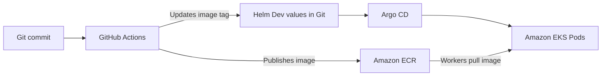
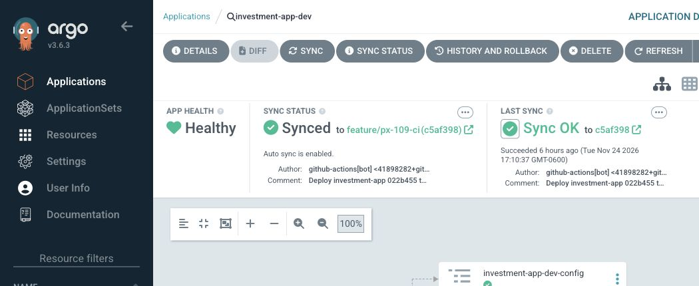
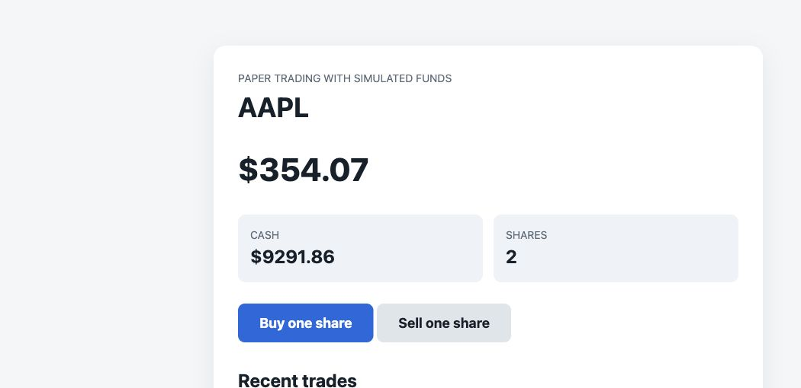

# Project X · ECS-to-EKS Migration

**312 School · DevOps Bootcamp**  
Chicago, Illinois, USA · April 2025–Present

Project X is a hands-on training project. I moved a sample Flask and PostgreSQL investment app from ECS with Fargate to a personal Dev EKS cluster and built a repeatable way to deliver updates.

## Case studies

- [CI/CD pipeline and Argo CD rollout](cases/ci-cd.md)
- [ECS and EKS migration rehearsal](cases/ecs-eks-comparison.md)

## What I built

- **Infrastructure.** I provisioned EKS and the Dev database network with Terraform. I reused my personal VPC, ran the lab workers in public subnets, and placed RDS PostgreSQL in private subnets.
- **Delivery.** GitHub Actions built the container, ran tests against temporary PostgreSQL, published a commit-tagged image to ECR, and committed the new tag to the Helm Dev values. Argo CD watched that branch and rolled out the change.
- **Capacity.** I configured Karpenter with Spot and On-Demand capacity and enabled interruption handling. When the system worker ran out of Pod slots, Karpenter added an On-Demand worker and the pending Argo CD Pods scheduled.
- **Browser access.** I configured Gateway API and the AWS Load Balancer Controller to route HTTPS traffic through an ALB. I used Route 53 and ACM for DNS and TLS.



## How I verified it

| Check | Observed result |
|---|---|
| CI | Build and PostgreSQL integration tests passed. |
| Image handoff | The full Git commit SHA on the ECR image matched the tag the bot wrote to the Helm Dev values. |
| Argo CD | The application was Synced and Healthy at the bot commit. |
| Kubernetes | Both app Pods were Ready and used the same image tag. |
| Browser | The app displayed the updated label through the HTTPS load balancer. |

### Deployment evidence

**Argo CD** reported the Dev application Synced and Healthy at deployment revision `c5af398`.



**Kubernetes** reported both Pods Ready on the same image tag that CI published to ECR and recorded in `values-dev.yaml`. The registry and image name are omitted below.

```text
POD                                   READY   IMAGE TAG
investment-app-dev-55d489dfd6-8bm8z   true    022b4553ef1a9551bac30507314835c439d116f1
investment-app-dev-55d489dfd6-j2jjd   true    022b4553ef1a9551bac30507314835c439d116f1
```

**HTTPS** served the updated application through the AWS load balancer. The page showed “Paper trading with simulated funds.”



## What I learned

When I installed Argo CD, several Pods stayed Pending. I checked the Kubernetes events and saw `Too many pods`. The first worker was already at its Pod limit. Karpenter brought up a second worker, and I checked that all seven Argo CD Pods were running and Ready.

Later, my GatewayClass stayed at `Unknown`. We checked the controller logs and found that it had started before the Gateway API definitions were installed. We restarted the controller, and the class changed to `Accepted=True`. After setting up the route, we opened the investment app through the HTTPS load balancer. Now I check what the scheduler or controller is reporting before I change the app.
