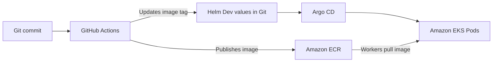

# Project X · ECS-to-EKS Migration

**312 School · DevOps Bootcamp**  
Chicago, Illinois, USA · April 2025–Present

Project X is a hands-on training project. I moved a sample Flask and PostgreSQL investment app from ECS with Fargate to a personal Dev EKS cluster and built a repeatable way to deliver updates.

## What I built

- **Infrastructure.** I provisioned EKS and the Dev database network with Terraform. I reused my personal VPC, ran the lab workers in public subnets, and placed RDS PostgreSQL in private subnets.
- **Delivery.** GitHub Actions built the container, ran tests against temporary PostgreSQL, published a commit-tagged image to ECR, and committed the new tag to the Helm Dev values. Argo CD watched that branch and rolled out the change.
- **Capacity.** I configured Karpenter with Spot and On-Demand capacity and enabled interruption handling. When the system worker ran out of Pod slots, Karpenter added an On-Demand worker and the pending Argo CD Pods scheduled.
- **Browser access.** I configured Gateway API and the AWS Load Balancer Controller to route HTTPS traffic through an ALB. I used Route 53 and ACM for DNS and TLS.

## How I verified it

| Check | Observed result |
|---|---|
| CI | Build and PostgreSQL integration tests passed. |
| Image handoff | The full Git commit SHA on the ECR image matched the tag the bot wrote to the Helm Dev values. |
| Argo CD | The application was Synced and Healthy at the bot commit. |
| Kubernetes | Both app Pods were Ready and used the same image tag. |
| Browser | The app displayed the updated label through the HTTPS load balancer. |

## What I learned

The Argo CD Pods initially hit the first worker’s Pod limit. Scheduler events distinguished a capacity problem from an application fault. The GatewayClass later remained unaccepted because the controller had started before the Gateway API definitions were installed. Its logs identified the missing definitions. A controller restart picked them up, and I verified that the class was accepted before provisioning the Gateway.
